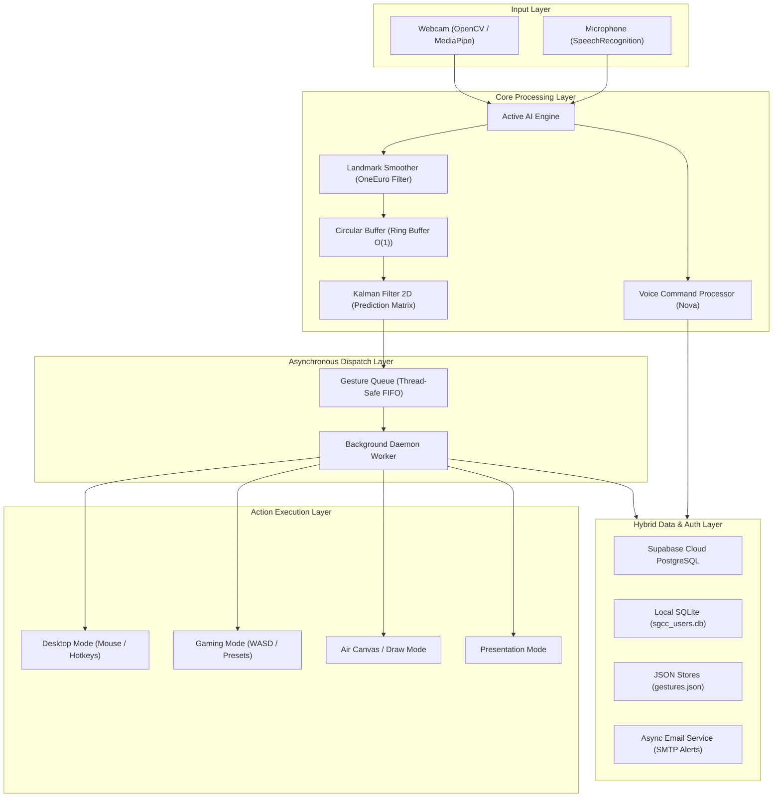
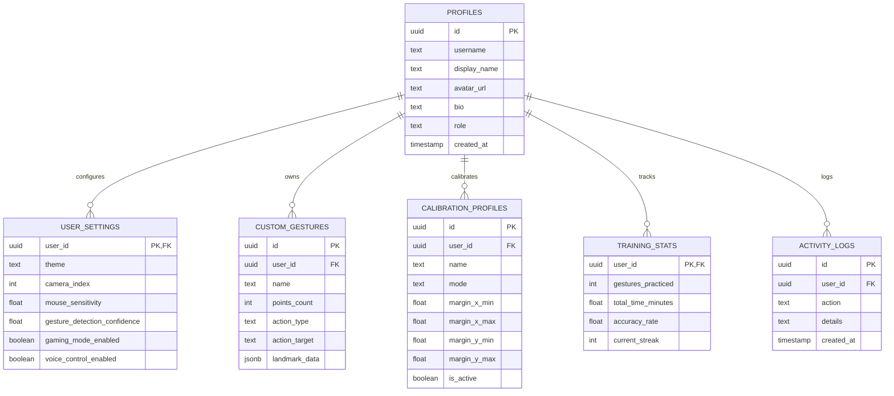

# 🖐️ Aurevix — Complete System Architecture & Data Structure Blueprint

> **Aurevix** is an AI-powered multimodal interaction platform combining Real-Time Computer Vision (MediaPipe), Speech Recognition, Digital Signal Processing (Kalman & OneEuro Filters), Cloud Database Architecture (Supabase PostgreSQL), and PyQt6/PySide6 desktop UI.

---

## 1. High-Level System Architecture



---

## 2. In-Depth Data Structures Breakdown

### 2.1 Circular Buffer (Ring Buffer) — $O(1)$
* **Location**: [`hand_tracking/ds_pipeline.py`](file:///c:/Users/PRATHA%20MORE/source/repos/Aurevix/PythonApplication2/hand_tracking/ds_pipeline.py)
* **Class**: `CircularBuffer(capacity=10)`
* **Design & Purpose**:
  * Fixed-capacity circular array to store the last $N$ landmark positions.
  * Eliminates hand jitter/shaking by computing a sliding moving average over recent coordinate tuples without dynamically reallocating memory.
* **Complexity**:
  * **Insert (`append`)**: $O(1)$ via circular modulo pointer `(head + 1) % capacity`.
  * **Fetch (`get_latest`)**: $O(1)$.
  * **Memory**: $O(N)$ bounded, preventing memory leaks during continuous tracking.

```python
class CircularBuffer:
    def __init__(self, capacity=10):
        self.capacity = capacity
        self.buffer = [None] * capacity
        self.head = 0
        self.size = 0

    def append(self, item):
        self.buffer[self.head] = item
        self.head = (self.head + 1) % self.capacity
        if self.size < self.capacity:
            self.size += 1

    def get_smoothed_point(self):
        valid = [p for p in self.get_all() if p is not None]
        return tuple(np.mean(valid, axis=0)) if valid else None
```

---

### 2.2 Thread-Safe FIFO Gesture Queue
* **Location**: [`hand_tracking/ds_pipeline.py`](file:///c:/Users/PRATHA%20MORE/source/repos/Aurevix/PythonApplication2/hand_tracking/ds_pipeline.py)
* **Class**: `GestureQueue(maxsize=50)`
* **Design & Purpose**:
  * Implements a classic **Producer-Consumer pattern**.
  * The camera thread produces recognized gesture events at ~30–60 FPS.
  * A dedicated background worker thread consumes and executes OS actions (mouse click, key press, volume change).
  * Prevents UI freeze/stutter even if an OS action takes a few milliseconds.
* **Underlying Structure**: `collections.deque(maxlen=maxsize)` protected by `threading.Lock`.

---

### 2.3 Mathematical State Vectors & Covariance Matrices (Kalman Filter 2D)
* **Location**: [`hand_tracking/core/filters.py`](file:///c:/Users/PRATHA%20MORE/source/repos/Aurevix/PythonApplication2/hand_tracking/core/filters.py)
* **Class**: `KalmanFilter2D`
* **Design & Purpose**:
  * 4-dimensional state vector $\mathbf{x} = \begin{bmatrix} x & y & v_x & v_y \end{bmatrix}^T$
  * $4 \times 4$ State Transition Matrix $\mathbf{F}$:
    $$\mathbf{F} = \begin{bmatrix} 1 & 0 & 1 & 0 \\ 0 & 1 & 0 & 1 \\ 0 & 0 & 1 & 0 \\ 0 & 0 & 0 & 1 \end{bmatrix}$$
  * Dynamically predicts mouse cursor trajectory and filters out noisy sensor data.
  * Includes automatic drift protection with periodic covariance resets.

---

### 2.4 Landmark Tensors & Spatial Arrays
* **Location**: [`hand_tracking/core/camera.py`](file:///c:/Users/PRATHA%20MORE/source/repos/Aurevix/PythonApplication2/hand_tracking/core/camera.py)
* **Structure**: NumPy `ndarray` of shape `(21, 3)`
* **Design & Purpose**:
  * Represents 21 landmarks of the human hand (wrist, thumb, index, middle, ring, pinky tips & joints).
  * Fast vector math (dot products, Euclidean distance, cross products) used for pinch detection and custom gesture template matching.

---

### 2.5 Hash Tables / Fast Dispatch Dictionaries — $O(1)$
* **Location**: Multiple modules
* **Implementations**:
  * `gaming_gesture_controller.py`: `GamePreset.bindings` (Maps detected gesture $\rightarrow$ Virtual Keyboard key).
  * `voice_command_processor.py`: Command routing dictionary (Maps spoken keyword phrase $\rightarrow$ Callback handler).
  * `user_gestures.py`: Landmark dictionary (Maps gesture ID $\rightarrow$ Vector geometry).

---

### 2.6 Strongly-Typed Dataclasses
* `CalibrationData` & `CalibrationProfile` in [`calibration_profiles.py`](file:///c:/Users/PRATHA%20MORE/source/repos/Aurevix/PythonApplication2/calibration_profiles.py): Screen boundary margins $(x_{min}, x_{max}, y_{min}, y_{max})$ and hologram visual state.
* `GamePreset` in [`gaming_gesture_controller.py`](file:///c:/Users/PRATHA%20MORE/source/repos/Aurevix/PythonApplication2/gaming_gesture_controller.py): FPS, Racing, and Action game presets.
* `Notification` in [`notification_manager.py`](file:///c:/Users/PRATHA%20MORE/source/repos/Aurevix/PythonApplication2/notification_manager.py): Toast notification model with unread state tracking.

---

## 3. Database Architecture & Schema

Aurevix uses a **Hybrid Cloud-Local Database Architecture**:
1. **Cloud PostgreSQL (Supabase)**: Multi-device sync, secure authentication, and cloud backup.
2. **Local SQLite (`sgcc_users.db`)**: Ultra-fast offline operation when internet is unavailable.



---

## 4. Codebase Directory Map

```text
Aurevix/
│
├── .env                              # Active Cloud Secrets (Supabase, SMTP, AI Keys)
├── .env.example                      # Template for configuration
├── .gitignore                        # Git exclusion (protects .env, *.db, pycache)
├── requirements.txt                  # Python dependencies (mediapipe, PySide6, supabase, etc.)
├── supabase_schema.sql               # Cloud PostgreSQL Schema (Tables, RLS, Triggers)
│
└── PythonApplication2/               # Main Application Source Code
    ├── main.py                       # 🚀 Root Application Entry Point & Navigation
    ├── auth_pages.py                 # Modern Authentication UI & Google OAuth Flow
    ├── supabase_manager.py           # Supabase Cloud Client & OAuth Callback Server
    ├── email_service.py              # Asynchronous SMTP Security Email Dispatcher
    ├── database.py                   # Local SQLite Client (sgcc_users.db) & Hybrid Sync
    ├── active_ai_engine.py           # Multimodal AI Engine (Vision + Voice threads)
    ├── voice_command_processor.py    # Voice Assistant (Nova) Command Dispatcher
    ├── audio_manager.py              # Sound effects (SFX) and TTS audio engine
    ├── profile_widget.py             # Top-right User Profile, Avatar, & Edit Dialog
    ├── top_navigation.py             # Top Navigation Bar, Notification Badge, Theme Switch
    ├── sidebar.py                    # Sidebar Navigation Icons & Route Controller
    ├── futuristic_dashboard.py       # Main telemetry dashboard with live visualizers
    ├── calibration_page.py           # Holographic camera boundary calibration UI
    ├── calibration_profiles.py       # Calibration data models & persistence
    ├── gaming_gesture_controller.py  # Gaming Controller (WASD, Presets, Keyboard bindings)
    ├── ai_trainer_game.py            # Interactive gesture training mini-game
    ├── logs_page.py                  # Live system audit & user activity log UI
    ├── notification_manager.py       # Real-time in-app notification manager
    │
    ├── hand_tracking/                # 🖐️ Computer Vision Core Package
    │   ├── ds_pipeline.py            # CircularBuffer & GestureQueue data structures
    │   ├── tracker.py                # MediaPipe hand tracking lifecycle
    │   ├── core/
    │   │   ├── camera.py             # Video capture, mirror, and frame pipeline
    │   │   ├── filters.py            # KalmanFilter2D, OneEuroFilter, LandmarkSmoother
    │   │   ├── hud.py                # Heads-up display visual overlay
    │   │   └── state.py              # Central tracking runtime state
    │   └── modes/
    │       ├── desktop_mode.py       # Virtual mouse, left/right click, scroll, drag
    │       ├── gaming_mode.py        # Directional gaming gesture controls
    │       ├── draw_mode.py          # Air Canvas drawing and painting
    │       └── presentation_mode.py  # Slide navigation, laser pointer, zoom
    │
    ├── gaming_mode/                  # Specialized gaming widgets and AI pattern learner
    ├── training_modes/               # Adaptive trainer, neural practice, reflex challenge
    └── drawings/                     # Saved Air Canvas screenshots and exported art
```

---

## 5. Execution Pipelines Summary

### A. Authentication Pipeline
1. User clicks **"Continue with Google"** in `auth_pages.py`.
2. `supabase_manager.py` starts a local loopback server at `http://localhost:54321/callback` and opens Google Auth in default browser.
3. User selects their Google account; Supabase exchanges code and verifies session.
4. Python fetches user metadata, strips trailing digits from email prefix, sets clean name (`Pratha More`) and initials (`PM`), and updates the database.
5. `email_service.py` fires an asynchronous cyberpunk-themed login alert email to the user's Gmail.
6. Local SQLite records a linked session for instant offline re-authentication.

### B. Tracking & Gesture Pipeline
1. Webcam captures frame at $60\text{ FPS}$ via OpenCV.
2. MediaPipe extracts $21$ hand landmarks in 3D coordinate space.
3. `LandmarkSmoother` runs 63 individual `OneEuroFilter` passes (x, y, z for 21 points).
4. `CircularBuffer` computes a moving average to suppress micro-jitters.
5. `KalmanFilter2D` predicts cursor destination.
6. Recognized gesture is enqueued in thread-safe `GestureQueue`.
7. Worker thread dequeues event and triggers corresponding Windows input API (via `pyautogui` / `pynput`).
