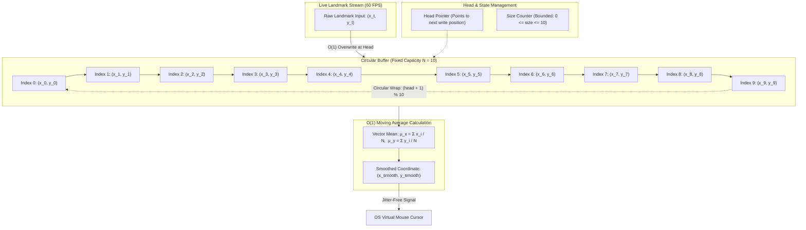
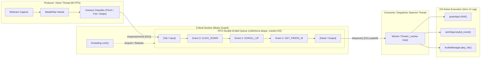
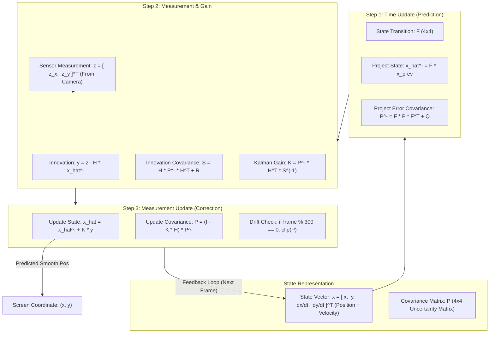
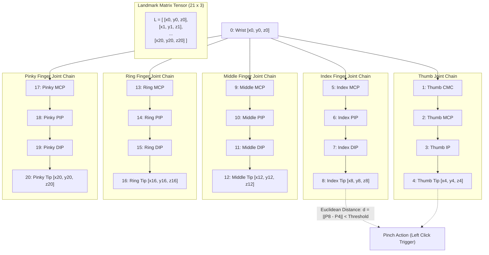
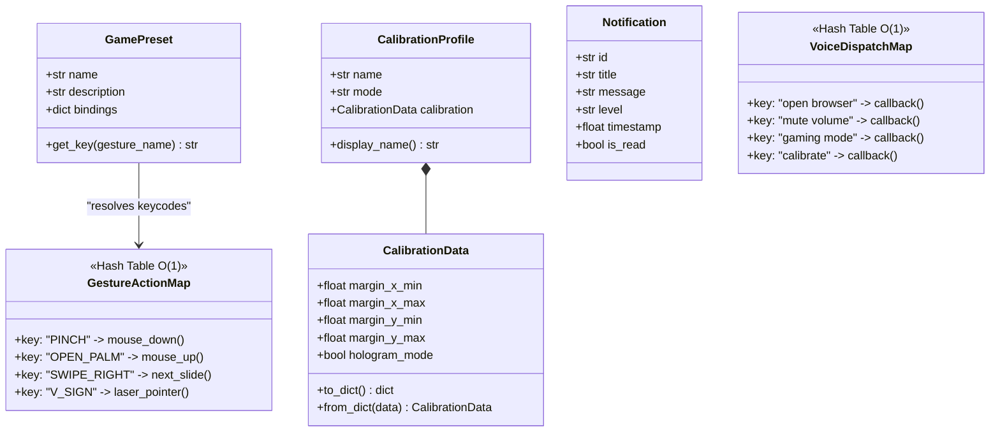

# 📊 Aurevix — Core Data Structures Visual Blueprint

This document contains visual architectural diagrams, state flows, and structural mappings for the five primary data structures powering the **Aurevix** Multimodal Interaction Engine.

---

## 1. Circular Buffer (Ring Buffer) — $O(1)$ Moving Average

Used in [`hand_tracking/ds_pipeline.py`](file:///c:/Users/PRATHA%20MORE/source/repos/Aurevix/PythonApplication2/hand_tracking/ds_pipeline.py) for real-time landmark stabilization and mouse cursor jitter elimination.

### Mathematical Formulation
Given a capacity $N=10$, each new measurement $p_t = (x_t, y_t)$ overwrites slot $h$:
$$\text{buffer}[h] \leftarrow p_t, \quad h \leftarrow (h + 1) \pmod N$$
The filtered coordinate $\bar{p}_t$ is computed via vector mean:
$$\bar{p}_t = \frac{1}{|S|} \sum_{i \in S} \text{buffer}[i], \quad S = \{i \mid \text{buffer}[i] \neq \text{None}\}$$

---

## 2. Thread-Safe FIFO Gesture Queue (Producer-Consumer)

Used in [`hand_tracking/ds_pipeline.py`](file:///c:/Users/PRATHA%20MORE/source/repos/Aurevix/PythonApplication2/hand_tracking/ds_pipeline.py) $\rightarrow$ `GestureQueue` to decouple video processing from OS action execution.

---

## 3. Kalman Filter 2D — State Estimation & Prediction

Used in [`hand_tracking/core/filters.py`](file:///c:/Users/PRATHA%20MORE/source/repos/Aurevix/PythonApplication2/hand_tracking/core/filters.py) $\rightarrow$ `KalmanFilter2D` for predicting cursor coordinates and preventing drift.

---

## 4. Spatial Landmark Tensors — 3D $(21, 3)$ Hand Graph

Used in [`hand_tracking/core/camera.py`](file:///c:/Users/PRATHA%20MORE/source/repos/Aurevix/PythonApplication2/hand_tracking/core/camera.py) and MediaPipe Hands to capture the geometric anatomy of the human hand.

---

## 5. Hash Tables & Dataclasses — $O(1)$ Dispatch Maps

Used across the application for instantaneous action lookup, key-binding resolution, and structured state holding.

---

## Summary Matrix

| Data Structure | Primary File | Access Complexity | Insert Complexity | Primary Purpose in Aurevix |
| :--- | :--- | :--- | :--- | :--- |
| **CircularBuffer** | `ds_pipeline.py` | $O(1)$ | $O(1)$ | 60 FPS coordinate window for moving average filter |
| **GestureQueue** | `ds_pipeline.py` | $O(1)$ | $O(1)$ | Thread-safe FIFO queue decoupling camera and OS actions |
| **KalmanFilter2D** | `filters.py` | $O(1)$ | $O(1)$ | 4D state vector & covariance matrix trajectory prediction |
| **Spatial Landmark Tensor** | `camera.py` | $O(1)$ | $O(1)$ | $21 \times 3$ coordinate matrix for hand skeleton geometry |
| **Hash Tables (`dict`)** | `gaming_gesture_controller.py`, `voice_command_processor.py` | $O(1)$ | $O(1)$ | Instant lookup for voice commands, game keys, and gesture types |
| **Dataclasses** | `calibration_profiles.py`, `notification_manager.py` | $O(1)$ | $O(1)$ | Strongly-typed, validated data representations |
