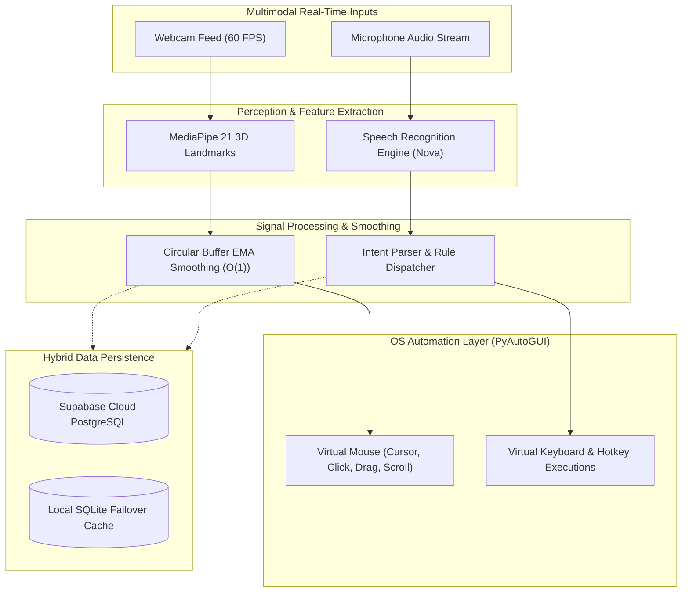

# Aurevix 🌐
### AI-Powered Multimodal Gesture & Voice Control Interaction Platform

[](https://www.python.org/)
[](https://riverbankcomputing.com/software/pyqt/)
[](https://developers.google.com/mediapipe)
[](https://supabase.com/)
[-E5243B.svg)](https://sdgs.un.org/goals/goal10)
[](LICENSE)

---

## 📖 Overview

**Aurevix** is an enterprise-grade, accessibility-first multimodal desktop interaction platform that replaces physical computer input peripherals (mouse and keyboard) with contactless **computer vision hand tracking** and **natural voice intelligence**.

Designed for high precision, real-time latency (<16ms, 60 FPS), and accessibility, Aurevix combines Google MediaPipe's 21 3D hand landmarks, speech recognition, and an ergonomic GUI with hybrid cloud-local data persistence via Supabase PostgreSQL and SQLite.

> **Primary UN Sustainable Development Goal:**  
> **SDG 10: Reduced Inequalities (Target 10.2)** — Providing assistive human-computer interaction for individuals with motor disabilities, arthritis, tremors, or physical limitations to ensure equal digital workspace accessibility.

---

## ✨ Key Features

- **🖐️ 3D Optical Hand Tracking**: 21 3D coordinates tracked in real time using MediaPipe Hands pipeline.
- **⚡ O(1) Exponential Moving Average (EMA) Smoothing**: Circular ring buffer to eliminate high-frequency hand tremors and micro-jitters without input lag.
- **🎙️ Nova Voice Assistant**: Natural speech control engine with multi-threaded listening and instant OS-level system triggers.
- **🔐 Hybrid Cloud Authentication**: Enterprise Google OAuth 2.0 PKCE loopback authentication + Supabase Cloud PostgreSQL with seamless offline SQLite caching.
- **🎨 Glassmorphic Desktop GUI**: Modern dark-mode interface built with PyQt5, featuring live gesture visualizers, customizable sensitivities, and calibration telemetry.
- **🖥️ Native Windows Executable**: Zero-dependency standalone build packaged via PyInstaller with hardware-accelerated webcam and audio pipelines.

---

## 🏗️ System Architecture



---

## 📁 Repository Structure

```text
Aurevix/
├── PythonApplication2/                 # Core application package
│   ├── GCVM/                           # Gesture Control & Vision Modules
│   │   ├── active_ai_engine.py         # MediaPipe pipeline & landmark extraction
│   │   ├── gesture_recognizer.py       # Gesture rule matchers & event dispatchers
│   │   ├── nova_voice.py               # Nova speech recognition & TTS system
│   │   └── Asset/                      # UI icons, logos, sound assets
│   ├── auth_pages.py                   # Login, signup, and OAuth UI workflows
│   ├── supabase_manager.py             # Supabase cloud synchronization client
│   ├── database.py                     # Local SQLite fallback & token storage
│   ├── profile_widget.py               # User settings, profile & sensitivity controls
│   └── email_service.py                # Asynchronous security alert mailer
├── docs/                               # Architecture diagrams & documentation
├── .env.example                        # Template for environment configuration
├── .gitignore                          # Standard git exclusion rules
├── aurevix.spec                        # PyInstaller build specification
├── requirements.txt                    # Python dependency manifest
├── supabase_schema.sql                 # Cloud PostgreSQL DDL schema & triggers
├── Launch_Aurevix.bat                  # One-click Windows runner
└── README.md                           # Project documentation
```

---

## 🚀 Getting Started

### Prerequisites

- **Python 3.9 or higher** (Tested on Python 3.9 - 3.11 64-bit)
- Standard USB / integrated webcam
- Microphone for voice command inputs
- Git

### 1. Clone the Repository

```bash
git clone https://github.com/prathamore8806/Aurevix.git
cd Aurevix
```

### 2. Create Virtual Environment

```bash
# Windows
python -m venv venv
.\venv\Scripts\activate
```

### 3. Install Dependencies

```bash
pip install --upgrade pip
pip install -r requirements.txt
```

### 4. Configure Environment Variables

Copy `.env.example` to `.env` and fill in your Supabase credentials:

```bash
cp .env.example .env
```

Edit `.env`:
```ini
SUPABASE_URL=https://your-project-id.supabase.co
SUPABASE_KEY=your-anon-public-key
```

### 5. Launch the Application

```bash
python PythonApplication2/main.py
```
Or simply double-click `Launch_Aurevix.bat` on Windows.

---

## 📊 Database Schema (Supabase PostgreSQL)

The platform utilizes a structured relational database with Row Level Security (RLS) on Supabase:
- `users`: Core profile data, display names, and authentication mapping.
- `gesture_profiles`: User-defined sensitivity thresholds, speed multipliers, and smoothing factors.
- `voice_commands`: Custom phrase-to-action bindings.
- `interaction_logs`: Telemetry and session usage metrics.
- `device_telemetry`: Hardware and camera performance diagnostics.

Execute `supabase_schema.sql` in the Supabase SQL Editor to initialize all tables and triggers automatically.

---

## 👥 Authors & Academic Affiliation

Developed as part of the Final Year Capstone Project (Academic Year 2025–2026):

**Department of Artificial Intelligence & Machine Learning (AIML)**  
**St. John College of Engineering and Management (SJCEM)**  
*(NAAC Accredited Grade A+ | Palghar, Maharashtra, India)*

| Name | Roll No. | Enrollment ID | Role |
| :--- | :---: | :---: | :--- |
| **Pratha More** | 64 | EU2256002 | Computer Vision, System Architecture & GUI |
| **Shirisha Vakiti** | 65 | EU2256001 | Cloud Database & OAuth Authentication |
| **Fraser Boban** | 66 | EU2256003 | Speech Processing & OS Automation |

---

## 📄 License

This project is licensed under the MIT License — see the [LICENSE](LICENSE) file for details.
